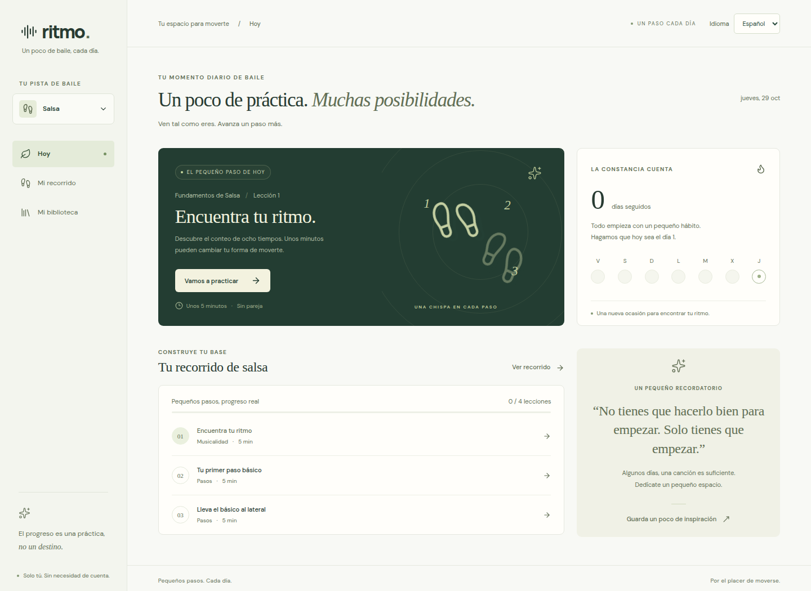
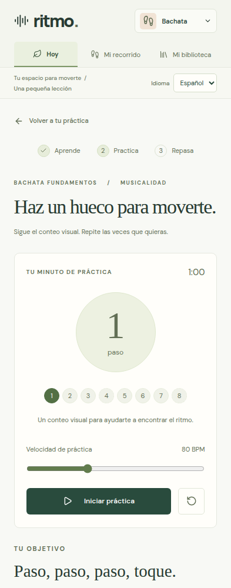

# Ritmo

A small dance tutor for Salsa and Bachata. Spanish by default, with an English language selector. No account needed; progress stays in this browser.

- `frontend/`: React, TypeScript and Vite, hosted on AWS Amplify.
- `backend/`: read-only content API as TypeScript AWS Lambda functions, deployed with Serverless Framework v4.

**Live app:** [Try Ritmo](https://main.d3k2uxz8qd3ag0.amplifyapp.com/) — hosted on AWS Amplify.

## What you can do

- Work through eight short lessons: learn the steps, practice and answer a quick question.
- Watch video demonstrations and use a one-minute visual count with adjustable tempo and pause/reset controls.
- Track completed lessons, daily activity and your practice streak.
- Keep your own YouTube, article and social links in a library for each dance style.

Choose rhythm, basic steps or combinations as your starting stage, independently for each style. Earlier lessons remain available for review and are only marked complete when finished. Existing saved progress is preserved.

## API

All endpoints accept `lang=es|en` (default `es`).

- `GET /api/health`
- `GET /api/styles`
- `GET /api/styles/{style}/lessons`: core lessons with their tutorial
- `GET /api/styles/{style}/playlist`: playlist details and its lessons by level

## Run locally

Use Node 24 or 26 and npm. The Serverless CLI (`npm i -g serverless`) needs a `serverless login`, even offline.

```sh
cd backend && npm ci && npm run dev     # API on http://127.0.0.1:3000
cd frontend && npm ci && npm run dev    # app on http://localhost:5173, proxies /api
```

## Screenshots

The daily Salsa dashboard in Spanish:



Guided Bachata practice on mobile:



## Checks

```sh
cd backend && npm run typecheck && npm test
cd frontend && npm run test:coverage && npm run build && npm run test:e2e
```

Browser tests use installed Google Chrome, with desktop and mobile viewports, and run against a production build on port 4173 with the API from `serverless offline`. If Chrome is unavailable, install it or change `channel` in `playwright.config.ts` to an installed Playwright browser.

## A few details

The practice count is visual. Tutorials follow your selected language: Spanish-speaking tutors Alfonso y Mónica in Spanish mode, and English-language demonstrations in English mode. Each video shows its audio language and a direct source link. Related lessons share full tutorials; changing language stops playback before loading the matching version.

## Deploy

1. API: `cd backend && npm run deploy -- --stage prod` (needs AWS credentials). Note the HTTP API URL it prints.
2. Amplify: the build uses `amplify.yml` with `appRoot: frontend`; set the app's `AMPLIFY_MONOREPO_APP_ROOT` environment variable to `frontend`. In Rewrites and redirects, add `/api/<*>` to `https://<api-id>.execute-api.<region>.amazonaws.com/api/<*>` as a `200 (Rewrite)`, above the SPA fallback rule.

## Data

Clearing browser data removes saved progress, preferences and links. Data is local to the browser and does not sync between devices.
