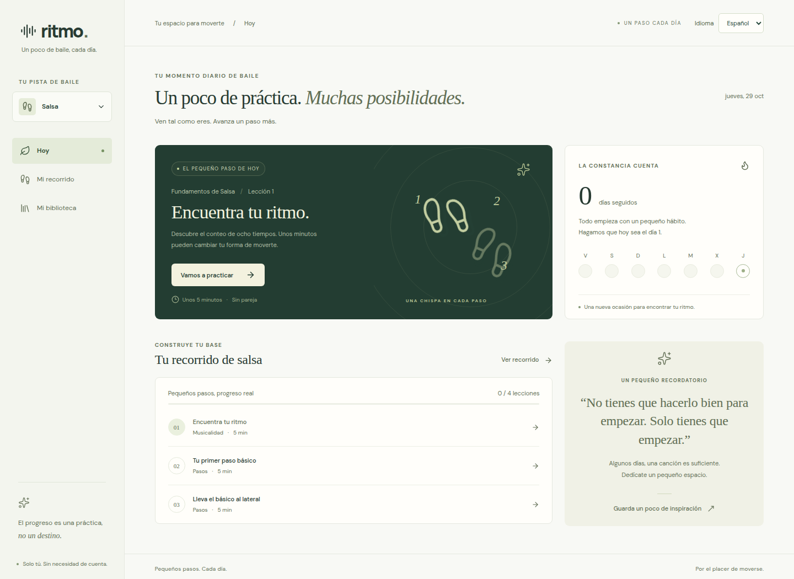
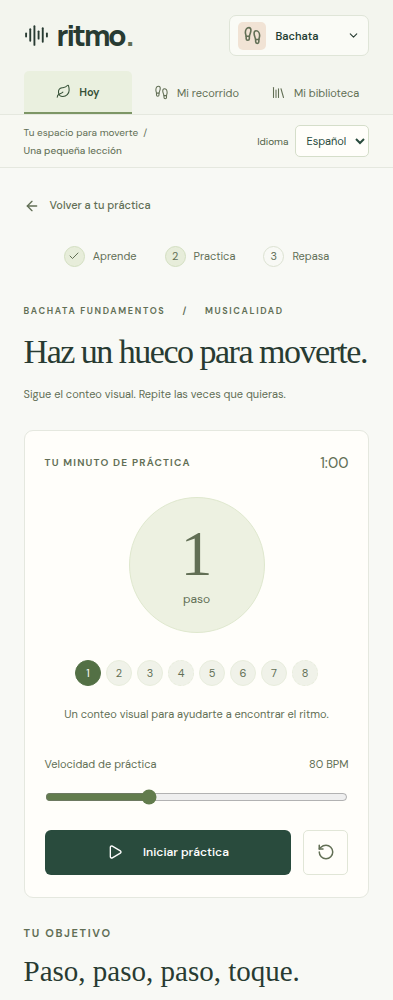

# Ritmo

A small React dance tutor for Salsa and Bachata, built with React, TypeScript and Vite. Spanish by default, with an English language selector. No account or backend; data stays in this browser.

**Live app:** [Try Ritmo](https://main.d3k2uxz8qd3ag0.amplifyapp.com/) — hosted on AWS Amplify.

## What you can do

- Work through eight short lessons: learn the steps, practice and answer a quick question.
- Watch video demonstrations and use a one-minute visual count with adjustable tempo and pause/reset controls.
- Track completed lessons, daily activity and your practice streak.
- Keep your own YouTube, article and social links in a library for each dance style.

Choose rhythm, basic steps or combinations as your starting stage, independently for each style. Earlier lessons remain available for review and are only marked complete when finished. Existing saved progress is preserved.

## Run locally

Use Node 26 and npm.

```sh
npm ci
npm run dev
```

Open http://localhost:5173.

## Screenshots

The daily Salsa dashboard in Spanish:



Guided Bachata practice on mobile:



## Checks

```sh
npm run test:coverage
npm run build
npm run test:e2e
```

Browser tests use installed Google Chrome, with desktop and mobile viewports, and run against a production build on port 4173. If Chrome is unavailable, install it or change `channel` in `playwright.config.ts` to an installed Playwright browser.

## A few details

The practice count is visual. Tutorials follow your selected language: Spanish-speaking tutors Alfonso y Mónica in Spanish mode, and English-language demonstrations in English mode. Each video shows its audio language and a direct source link. Related lessons share full tutorials; changing language stops playback before loading the matching version.

Clearing browser data removes saved progress, preferences and links. Data is local to the browser and does not sync between devices.
